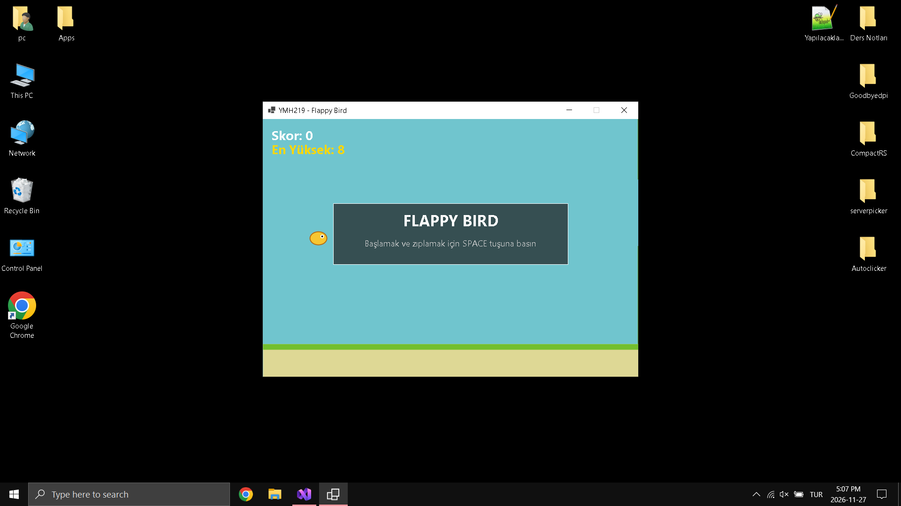
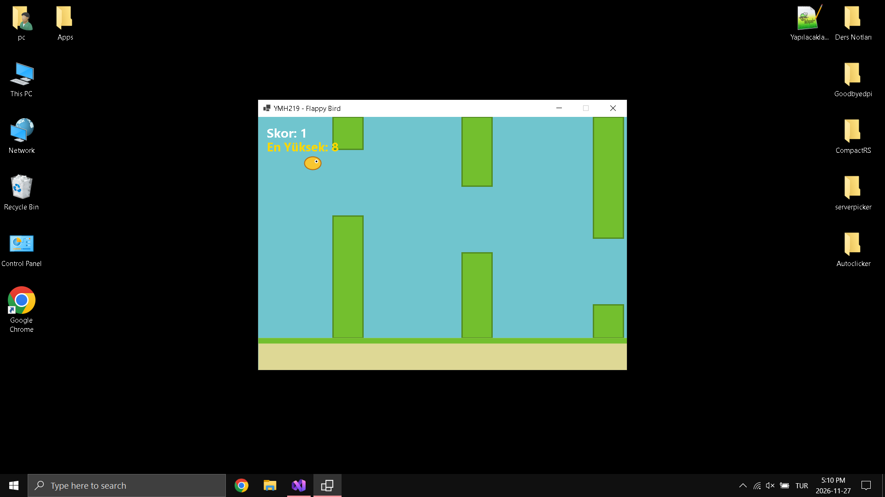

## Proje Hakkında
Bu proje, **Nesne Tabanlı Programlama (YMH 219)** dersi kapsamında C# ve Windows Forms kullanılarak geliştirilmiş masaüstü bir Flappy Bird oyunudur. Oyun döngüsü, yer çekimi fiziği, engel yönetimi ve çarpışma kontrolleri arayüz katmanından bağımsız nesne tabanlı sınıflar ile yönetilmektedir.

## Kullanılan Teknolojiler
- **Programlama Dili:** C# 12
- **Platform:** .NET 8.0 (Windows Forms)
- **Grafik Çizimi:** System.Drawing (GDI+)
- **Geliştirme Ortamı:** Visual Studio 2022

## Kurulum ve Çalıştırma Adımları
1. Depoyu bilgisayarınıza klonlayın:
   ```bash
   git clone https://github.com/GurkanBugdaycioglu/YMH219-FlappyBird.git
   ```
2. Proje klasöründeki `YMH219-FlappyBird.sln` dosyasını Visual Studio ile açın.
3. Üst menüden **Start** butonuna tıklayarak veya `F5` tuşuna basarak uygulamayı derleyip çalıştırın.
4. Oyunu başlatmak ve kuşu zıplatmak için `Space` veya `Yukarı Yön (Up)` tuşunu kullanın.

## Ekran Görüntüleri
| Oyun Açıldığında | Oyun İçi Görünüm |
| :---: | :---: |
|  |  |

## Geliştirici Bilgileri
- **Adı Soyadı:** Gürkan Buğdaycıoğlu
- **Öğrenci Numarası:** 200541048